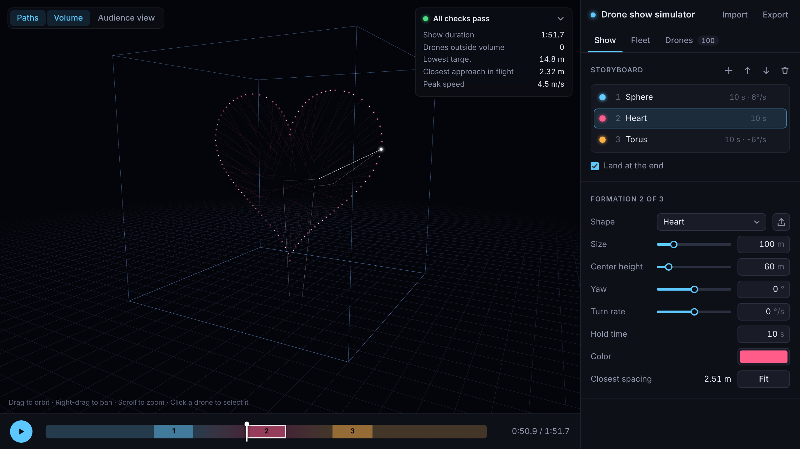

# Drone show simulator

A browser tool that previews a drone light show in 3D.
The drones take off from a ground grid, fly to each formation of a storyboard in turn, and land.



The page is static files. It has no dependencies and no build step.

## Run it

Serve the folder with any static file server, then open the page:

```sh
uv run python -m http.server 8000
```

Open `http://localhost:8000/`. The browser must support WebGL2.

## Use it

| Input | Action |
|---|---|
| Drag in the 3D view | Orbit |
| Right-drag or Shift-drag | Pan |
| Wheel | Zoom |
| Click a drone or a row of the drone list | Select that drone |
| Click a storyboard row or a timeline block | Select that formation |
| Click empty space, or Escape | Clear the selection |
| Space | Play or pause |
| Ctrl+Z, or ⌘Z on a Mac | Undo |
| Ctrl+Shift+Z, Ctrl+Y, or ⇧⌘Z | Redo |

The sidebar has three tabs.

| Tab | What it does |
|---|---|
| Show | The storyboard lists the formations of the show in order. Its buttons add, move, and remove formations. Below it, you set the shape, size, height, rotation, turn rate, hold time, color, and light chase of the selected formation. A formation with a turn rate turns slowly in its hold. A light chase sends bright bands across the formation in its hold, like the bulbs of a theater marquee. Fit sets the smallest size that keeps the minimum spacing, also in flight. |
| Fleet | Sets the drone count, the takeoff grid, the speed and acceleration limits, the minimum spacing, and the flight volume: the cube that the drones must stay inside. "Spread out to pass safely" lets the fleet open out before a crossing that would bring drones too close (on by default). |
| Drones | Lists each drone with its position and speed at the current time. |

The sidebar header has Undo and Redo buttons and a Project menu. Every change to the show can be undone; a slider drag counts as one step.
The show saves in your browser as you work, so a page reload brings it back. In the Project menu, New show starts again from the default show (Undo brings the old one back), and Import and Export load and save the show as a JSON file.

Overlays on the 3D view show or hide the flight paths and the flight volume, and move the camera to where the audience stands.
The Checks panel at the top right shows the show duration, the drones outside the flight volume, the lowest target, the closest approach in flight, and the peak speed. It lists each problem in words. A click on its status line folds it.

The timeline strip under the 3D view shows the whole show: one block per flight and one per hold. Drag the playhead to move through the show.

A shape is one of seven built-in shapes, an OBJ model, or an SVG drawing. The button next to the Shape list imports a file.

- An OBJ model gets drones on its surface. The importer reads vertices and faces. It ignores materials and textures.
- An SVG drawing gets drones on its outlines, and it stands upright facing the audience. The importer reads paths, rectangles, circles, ellipses, lines, polylines, polygons, and transforms. It does not read text, so convert text to paths first.

Above 250 drones, the sliders for drone count, yaw, and turn rate apply their value when you let go. The others apply at once at every fleet size.

## How it works

`SPEC.md` describes the design: the terms, the steps from shape to flight plan, and the project file format.

In short:

1. Each shape becomes 20,000 random points.
2. Farthest point sampling picks one evenly spread target per drone.
3. For each flight, an assignment solver pairs the drones with the targets so that the total of squared flight distances is the smallest. With these pairs, straight paths do not cross closer than 0.7 times the spacing.
4. When a direct flight would still bring drones too close, the fleet spreads out first: the formations grow, the drones cross, and the new formation closes up. A larger spacing at both ends makes the crossing safe, and the pairs stay the best ones.
5. In each flight, all drones fly on one shared accelerate, cruise, brake profile. The profile is the fastest one that keeps every drone inside every limit.

## Test it

Both commands need Node 20 or later. Neither needs `npm install`.

```sh
npm test          # unit tests for the math
npm run smoke     # opens the page in headless Chrome and checks that it draws a frame
```

The smoke test needs Chrome or Chromium. Set `CHROME_PATH` if the script does not find the browser.

## Publish it on GitHub Pages

1. Make the repository public.
2. In the repository settings, open Pages.
3. Select "Deploy from a branch", then the branch and the `/ (root)` folder.

The empty `.nojekyll` file tells Pages to serve the files as they are.
